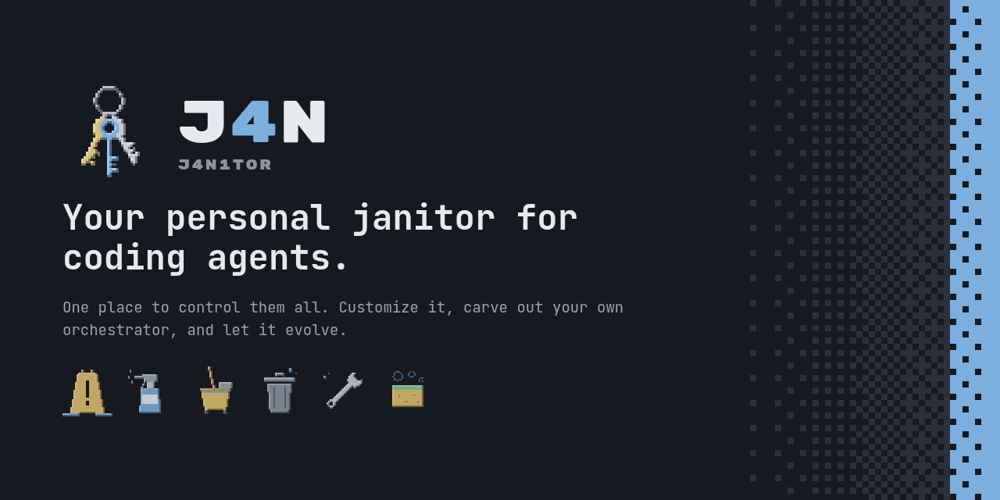

<p align="center"></p>

# J4n

**Your personal janitor for coding agents.** A control layer for the command-line agents you already use. J4n1tor in
full; `j4n` is what you type.

J4n runs on top of the agents you already use (Claude Code, Codex, Gemini CLI, OpenCode, Pi, or any CLI you describe to
it). Every task goes through one permission gate, is charged to one cost line and is recorded in one event log per project.
It is a single Rust binary with a terminal UI, a one-shot mode and a pipe mode.

<p align="center"><br>
<sub>The real <code>j4n</code> screen in orchestrate mode (experimental). The agents here are scripted stand-ins for Claude Code and Codex, so no model was called.</sub></p>

> [!WARNING]
> **Wet floor.** 0.1.0, experimental. The core is built and tested. Features marked *experimental* are off by default and
> have not yet been shown to help. See [Status](#status).

```bash
curl -fsSL https://raw.githubusercontent.com/J4n1tor/J4n/main/install.sh | sh
cd your-project && j4n doctor && j4n
```

## Why

Running several agents means several permission systems, several ways of reporting cost, and no common record of what
happened. J4n puts one layer over all of them:

- **One gate.** Writes outside the project, commands that change state, and network access are checked by one rule set
  and approved in one place. The agents never see the keys J4n holds, and secrets are redacted from what they read.
- **Cost and result per task.** Each task shows what it cost (money, or the share of a subscription's limit window) and
  whether the project's own checks passed afterwards.
- **Cheapest route first.** Plain code before a small model, a small model before a large one.
- **Extensible by data.** Behaviour lives in *packs*: TOML files for rules, connectors, screens and flows. J4n can
  propose a pack change from a description; nothing changes until you accept it, and every change can be undone.

J4n never reads or stores an agent's login. Each agent keeps its own sign-in; J4n starts the agent as it is.

People come to J4n for different reasons: to keep control of an agent they must use as it is, to give different work
to different providers, to have one screen instead of several, or to build their own layer on top. [docs/ABOUT.md](docs/ABOUT.md)
describes it from each of these angles, says what works today, and lists what it could become.

## Install

| Platform | How |
|---|---|
| Linux x86_64 / aarch64, any distribution (glibc or musl) | `install.sh` (one static binary) |
| macOS 11 or later, arm64 / x86_64 | `install.sh` (binaries built in CI; see [Status](#status)) |
| Windows | inside [WSL2](https://learn.microsoft.com/windows/wsl/install), then as Linux |
| Anything else | `cargo install --git https://github.com/J4n1tor/J4n --locked j4n` |

The installer puts `j4n` in `~/.local/bin` (`J4N_BIN_DIR` changes it, `J4N_VERSION=v0.1.0` pins a release), checks the
download's SHA-256, prints the `PATH` line for your shell (`J4N_MODIFY_PATH=1` adds it) and names the programs J4n uses
that are missing. To build from a clone, run `cargo build --release -p j4n --locked`; the toolchain is pinned in
`rust-toolchain.toml`.

You also need at least one agent CLI, already signed in. Optional tools, used only by the features that need them:

| Tool | Used for | Linux | macOS |
|---|---|---|---|
| `git` | checkpoints, worktrees, lanes | distro package | Xcode CLT / Homebrew |
| [bubblewrap](https://github.com/containers/bubblewrap) | `--place box` (sandboxed task) | `bwrap` package | not available |
| Python 3 | the `kit` pack | distro package | preinstalled / Homebrew |
| Chromium, Chrome, Brave or Edge | the `accounts` pack (one window per account) | any of them | any of them |

`j4n doctor` reports what it found and what is missing. Details: [docs/INSTALL.md](docs/INSTALL.md).

## Usage

```bash
j4n                              # the terminal UI
j4n run "fix the failing test"   # one task, answer on stdout
echo "explain src/main.rs" | j4n # piped: one line per turn
j4n doctor                       # agents, sign-ins, keys, safety defaults
j4n --help
```

In a new folder J4n creates `.j4n/` (git-ignored) for the project's log. Work is done behind a checkpoint you can rewind to.
Anything the gate marks as risky comes to an approval card first.

## Features

**Core (on by default):** the permission gate and key guard; cost per task with subscription limit windows; checks
after edits; the event log; connectors for Claude Code, Codex, Gemini CLI, OpenCode and Pi, plus any CLI J4n learns by
probing it; Grow (pack proposals with accept and undo); chats, where each prompt can be its own thread.

**Packs (built in, off until enabled under Settings › Packs, or all at once with `packs.full`):** several accounts per
agent, each with its own browser window and proxy; offload of light chores to a cheaper agent; lanes and an orchestrate
mode (a planner with branches); a Python tool for J4n's own agent; quality marks; prompt shaping; inbox, habits,
reflexes, ledger; a skill library; remote places.

The full list, with what each one does and its default, is in [docs/FEATURES.md](docs/FEATURES.md).

## Status

J4n is in beta: every release below 1.0.0 is a beta and may change how things work. A release is numbered 0.1.0, 0.1.1,
0.1.2 and so on, and the middle number goes up when a larger stage is done.

"Built" means it exists and has tests. "Measured" means a run against real tasks showed it helps.

| Feature | Default | State |
|---|---|---|
| Gate and key guard | on | built; the gate's attack drills pass |
| Cost per task, plan limit windows | on | built |
| Checks after edits | on | built, not measured |
| Event log | on | built |
| Grow (proposals, undo) | on | built |
| Connectors (Claude Code, Codex, Gemini CLI, OpenCode, Pi, learned CLIs) | on | built |
| Chats | setting, off | built |
| Accounts | pack, off | experimental |
| Offload | pack, off | experimental; helped on one model, not on a smaller one |
| Lanes / orchestrate | pack, off | experimental; not better than a single lane in tests so far |
| Kit, quality marks, shaping, inbox, habits, reflexes, ledger | packs, off | experimental, not measured |

Development and the full test suite run on Linux. On macOS the binaries are built in CI; its test suite does not yet block
a merge. The `box` place needs bubblewrap, so it is Linux only. Native Windows is not supported.

## Documentation

| | |
|---|---|
| [docs/ABOUT.md](docs/ABOUT.md) | what J4n is, from several angles, and where it could go |
| [docs/INSTALL.md](docs/INSTALL.md) | install, per-OS dependencies, uninstall |
| [docs/GUIDE.md](docs/GUIDE.md) | the screen, chats, accounts, cost |
| [docs/FEATURES.md](docs/FEATURES.md) | every feature and pack, with defaults |
| [docs/GATE.md](docs/GATE.md) | the gate, the key guard, sandboxing |
| [docs/PACKS-GUIDE.md](docs/PACKS-GUIDE.md) | writing a pack |
| [docs/ARCHITECTURE.md](docs/ARCHITECTURE.md) | crates, protocol, design laws |
| [docs/BRAND.md](docs/BRAND.md) | the mark, the wordmark, colours, rebuilding the art |
| [CONTRIBUTING.md](CONTRIBUTING.md), [docs/TESTING.md](docs/TESTING.md) | working on J4n |
| [SECURITY.md](SECURITY.md) | reporting a vulnerability |
| [docs/THANKS.md](docs/THANKS.md) | the projects J4n is built with and the agents it works with |

## Provider terms

J4n starts each agent's own unmodified CLI with the login that CLI already has. It does not offer a sign-in of its own, and
it does not proxy or resell access. You are responsible for using each provider within its terms.

## Thanks

J4n is built on [ratatui](https://github.com/ratatui/ratatui), [crossterm](https://github.com/crossterm-rs/crossterm),
[serde](https://github.com/serde-rs/serde) and many more crates, and it works through the agents you already use. Thank you to
all of them: [docs/THANKS.md](docs/THANKS.md) names each one.

## License

[MIT](LICENSE). The licenses of the crates in the binaries are listed in [docs/THIRD-PARTY.md](docs/THIRD-PARTY.md).

## Creator note

> I needed a tool. I made the tool. I shared the tool.

<p align="center"></p>
