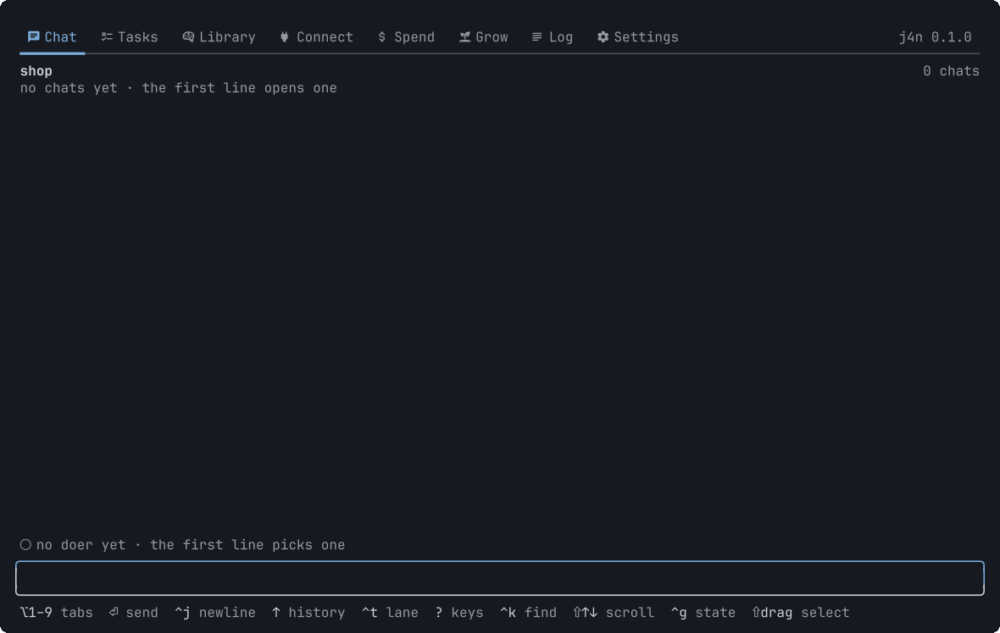
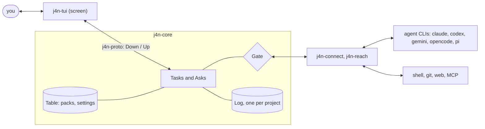

<p align="center"></p>

# J4n

J4n is a meta-harness for command-line coding agents. It starts the agents you already have (Claude Code, Codex, Gemini
CLI, OpenCode, Pi, or any CLI it learns), sends every step they take through one permission gate, writes every event to
one log per project, and charges every task to one cost line. It is a single Rust binary with no async runtime and no
service behind it. Behaviour beyond the core is data: TOML *packs*.

> [!NOTE]
> 0.1.x is a beta. The core (gate, log, tasks, connectors, cost) is built and tested. Most packs are off by default and
> not yet shown to help on real tasks. See [Status](#status).

<p align="center"><br>
<sub>The terminal screen, orchestrate mode. The agents are scripted stand-ins, so no model was called.</sub></p>

## How it fits together



- **j4n-core** holds every decision. It reads no terminal and starts no process itself.
- **j4n-connect** and **j4n-reach** are the only crates that touch the outside: processes, worktrees, sandboxes, HTTP, MCP.
- **j4n-tui** draws what the core sends over `j4n-proto` and returns typed intents. It depends on nothing else in J4n.

The detail is in [docs/ARCHITECTURE.md](docs/ARCHITECTURE.md).

## Concepts

| Word | Meaning |
|---|---|
| doer | Who runs a task: an agent CLI (through a connector), a flow of steps, or you. |
| task | All work. A chat turn, a check, a flow step and a question are tasks. States: queued, running, cooling, waiting, done, stopped. |
| place | Where a task runs: `here` (the project), a git `worktree`, or a bubblewrap `box`. |
| gate | One rule set every effect passes before it runs: allow, ask, or block. Block beats ask beats allow. |
| grant | Your yes to a kind of effect, for once, a task, a session or always in this project. A grant never lifts a block. |
| ask | A decision as a child task, answered by a chain: rule → decider → you. An approval is never answered by a model. |
| pack | A folder of TOML rows: settings, rules, gates, flows, connectors, pages, commands. 24 are built in. |
| flow | A pack-declared sequence of steps (plan → work → check) whose doers and models are data. |
| log | Append-only JSONL of every event, in `.j4n/log/` of the project. Every view and every cost figure is a fold over it. |

## Install

```bash
curl -fsSL https://raw.githubusercontent.com/J4n1tor/J4n/main/install.sh | sh
```

| Platform | How |
|---|---|
| Linux x86_64 / aarch64 (glibc or musl) | `install.sh`: one static binary into `~/.local/bin`, SHA-256 checked |
| macOS 11+, arm64 / x86_64 | `install.sh` (built in CI; its tests do not yet block a merge) |
| Windows | inside WSL2, as Linux |
| From source | `cargo install --git https://github.com/J4n1tor/J4n --locked j4n` (toolchain pinned in `rust-toolchain.toml`) |

Installer variables: `J4N_BIN_DIR` (target folder), `J4N_VERSION=v0.1.0` (pin), `J4N_MODIFY_PATH=1` (edit your shell's
`PATH`). You need at least one agent CLI, signed in. Optional programs:

| Program | Needed by |
|---|---|
| `git` | checkpoints, worktrees, lanes |
| `bwrap` (bubblewrap) | the `box` place; Linux only |
| Python 3 | the `kit` pack |
| Chromium, Chrome, Brave or Edge | the `accounts` pack |

`j4n doctor` lists what it found and what is missing. More: [docs/INSTALL.md](docs/INSTALL.md).

## Use

```bash
cd your-project
j4n doctor                       # agents, sign-ins, keys, safety defaults
j4n                              # the terminal screen
j4n run "fix the failing test"   # one task; the answer on stdout
echo "explain src/main.rs" | j4n # one line per turn on stdin
```

J4n makes `.j4n/` in the project (git-ignored) for its log. Edits happen behind a checkpoint you can rewind. An effect the
gate marks as risky waits on an approval card. Commands typed in the chat (`:pack`, `:grant`, `:clear`, …) are listed in
[docs/reference/commands.md](docs/reference/commands.md).

## What the core does

| Feature | Behaviour |
|---|---|
| Gate | Checks writes, commands and network use. Writes outside the project ask; J4n's own folder and git internals are blocked. [docs/GATE.md](docs/GATE.md) |
| Key guard | Keys J4n holds never reach an agent. Secrets in the log and in what a model reads are replaced by shape-keeping placeholders. |
| Checkpoints | `:undo` and rewind take work back. |
| Cost | Money for API use; the share of the limit window for subscription plans. Per task. |
| Checks | After edits, the project's own test command runs (detected per language). |
| Connectors | Claude Code, Codex, Gemini CLI, OpenCode, Pi; `/connect <program>` probes any other CLI and proposes a connector. |
| Grow | J4n drafts a pack change from a description. Nothing applies until you accept it; every change can be undone. |

Every pack, with its default and what it adds: [docs/reference/packs.md](docs/reference/packs.md). Every setting:
[docs/reference/settings.md](docs/reference/settings.md).

## Status

*Built* means it exists and has tests. *Measured* means a run on real tasks showed it helps.

| Part | Default | State |
|---|---|---|
| Gate, key guard | on | built; the gate's attack drills pass |
| Log, tasks, checkpoints | on | built |
| Cost, plan limit windows | on | built |
| Connectors | on | built |
| Checks after edits | on | built, not measured |
| Grow | on | built |
| Lanes / orchestrate | off (`lanes = single`) | experimental; not better than a single lane in tests so far |
| Offload | pack, off | experimental; helped on one model, not on a smaller one |
| Accounts, kit, qc, shape, inbox, habits, reflexes, ledger | packs, off | experimental, not measured |

Development and the full test suite run on Linux. J4n does not make an agent smarter by itself. It is not a hosted
service: nothing leaves the machine except what the agents you run send.

## Documentation

| Doc | For | Content |
|---|---|---|
| [docs/README.md](docs/README.md) | everyone | index of all docs |
| [AGENTS.md](AGENTS.md) | coding agents | a map of the code: where each thing lives and how to change it |
| [docs/ARCHITECTURE.md](docs/ARCHITECTURE.md) | contributors | parts, crates, protocol, life of a line |
| [docs/GUIDE.md](docs/GUIDE.md) | users | the screen, chats, approvals, cost |
| [docs/GATE.md](docs/GATE.md) | users, reviewers | the gate, the key guard, sandboxing, known attacks |
| [docs/PACKS-GUIDE.md](docs/PACKS-GUIDE.md) | pack authors | writing a pack |
| [docs/reference/](docs/reference/) | everyone | settings, commands and packs, generated from the pack rows |

## Provider terms

J4n starts each agent's own unmodified CLI with the login that CLI already has. It never reads or stores a login, offers no
sign-in of its own, and does not proxy or resell access. You are responsible for using each provider within its terms.

## License

Licensed under either of [Apache License, Version 2.0](LICENSE-APACHE) or [MIT license](LICENSE-MIT), at your option.
Unless you state otherwise, any contribution you submit for inclusion in J4n is dual-licensed as above, without any
additional terms. The licenses of the crates in the binaries are in [docs/THIRD-PARTY.md](docs/THIRD-PARTY.md); the
projects J4n is built with are thanked in [docs/THANKS.md](docs/THANKS.md).

---

<sub>The README and the docs are AI-generated under the maintainer's supervision and review.</sub>
