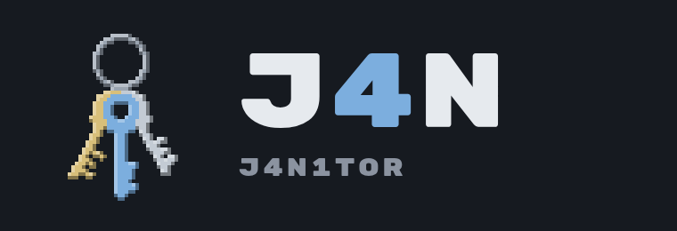

# The J4n look

J4n is the short mark and what you type (`j4n`); **J4n1tor** is the full name. It is never shortened to "J4".

<p></p>

Everything in `assets/` is drawn from shapes by `scripts/brand/render.py`, so any file can be made again:

```bash
python3 scripts/brand/render.py --fonts DIR   # DIR holds RubikMonoOne-Regular.ttf and JetBrainsMono.ttf (SIL OFL)
```

Without Chromium or the fonts, the script still makes the pixel art; the banner and the lockups need both.

## The mark

A key ring with three keys: brass, steel and the accent. The janitor holds the keys; J4n keeps yours away from every
agent. The ring has no tag and no letters on it.

| File | Use |
|---|---|
| `assets/mark.svg`, `assets/mark-48.svg` | the mark at its full drawing, 48×48 cells |
| `assets/mark-32.svg`, `assets/mark-16.svg` | the small grids; the 16 is drawn by hand so the three bows stay apart |
| `assets/png/mark-{16,32,48,64,96,128,192,256,384}.png` | each size from the native grid it is a whole multiple of, never resampled |
| `assets/png/avatar.png` | the mark on the jjj ground, square, for a profile picture |

Show the pixel art with nearest-neighbour scaling (`image-rendering: pixelated`) and at whole multiples only.

## The wordmark

**J4n** set in [Rubik Mono One](https://fonts.google.com/specimen/Rubik+Mono+One), the 4 in the accent, with **J4n1tor**
under it in the same face, smaller and dimmed. The face sets everything in capitals.

| File | Use |
|---|---|
| `assets/png/lockup-dark.png` | ring + wordmark on the jjj ground |
| `assets/png/lockup-light.png` | ring + wordmark on a clear ground, darker text and accent, for light pages |

## The banner

`assets/png/banner.png`, 1280×640: the ring and the wordmark, the headline and its line, the shelf of janitor symbols,
and a dithered sweep on the right that ends in the accent. It is the README header and the repository's social preview.

> **Your personal janitor for coding agents.** One place to control them all. Customize it, carve out your own
> orchestrator, and let it evolve.

## Colour: jjj

The brand palette is the TUI's default palette, `jjj` (Settings › Look).

| Role | Dark | On a light page |
|---|---|---|
| ground | `#161a20` | (the page) |
| text | `#cdd2d8`, bright `#e6eaee` | `#24292f` |
| dim | `#8b93a0` | `#59636e` |
| accent | `#7caede` | `#2c6aa3` |
| line | `#2a313c` | |
| brass, steel, ring | `#d8bf7a`, `#c3cbd4`, `#9aa4b0` | the same |

## Type

Rubik Mono One for the wordmark only. JetBrains Mono for every other line of text on the art, matching the terminal.

## The janitor symbols

Things from the janitor's cart, 32×32 each in `assets/symbols/`: a wet-floor sign, a spray bottle, a mop bucket, a bin,
a wrench, a sponge, a padlock, an ID badge, a receipt, a clipboard, a flashlight, a walkie-talkie, a ladder, a toolbox
and binoculars. The shelf (`assets/shelf.svg`, `assets/png/shelf.png`) and the banner's strip are the first six, side
by side.

They set the theme and nothing else. **A symbol never stands for a feature**: no "the wrench is the gate". Use them as a
strip or a shelf to divide a page, and the wet-floor sign beside a note that something is experimental.

## The demo GIF

`assets/demo.gif` is the real `j4n` screen in orchestrate mode, recorded by `scripts/brand/demo/record.py` in a small
sample web API (`shop`). One line asks for a per-client rate limit and a `/health` endpoint with tests. A cheap model reads
it as a split, and the card asks before two chats start, each in a worktree of its own. The project's own tests run on
each chat's work, and Codex reviews it: it finds that the limiter keeps one list for every client, so that chat goes back
and fixes it. Both parts are laid in. Main joins them; its delete of an old file waits on an approval card, and its force
push is blocked by the gate. Codex reviews Main's change too. Then the Tasks, Spend and Log tabs.

The agents are scripted stand-ins for Claude Code and Codex (`standin.py`): they answer J4n by what it asks them, so no
model is called and nothing leaves the machine. Their edits and test runs are real, in J4n's worktrees. J4n itself runs as
it always does, in a throwaway home and project.

```bash
python3 scripts/brand/demo/record.py --bin target/release/j4n   # needs tmux, git, python3, rsvg-convert, ffmpeg, JetBrainsMono Nerd Font
```

`--keep DIR` keeps the frames (and `frames.json`, the take as captured); `--again DIR/frames.json` draws the GIF again from
a kept take, with no new take.
